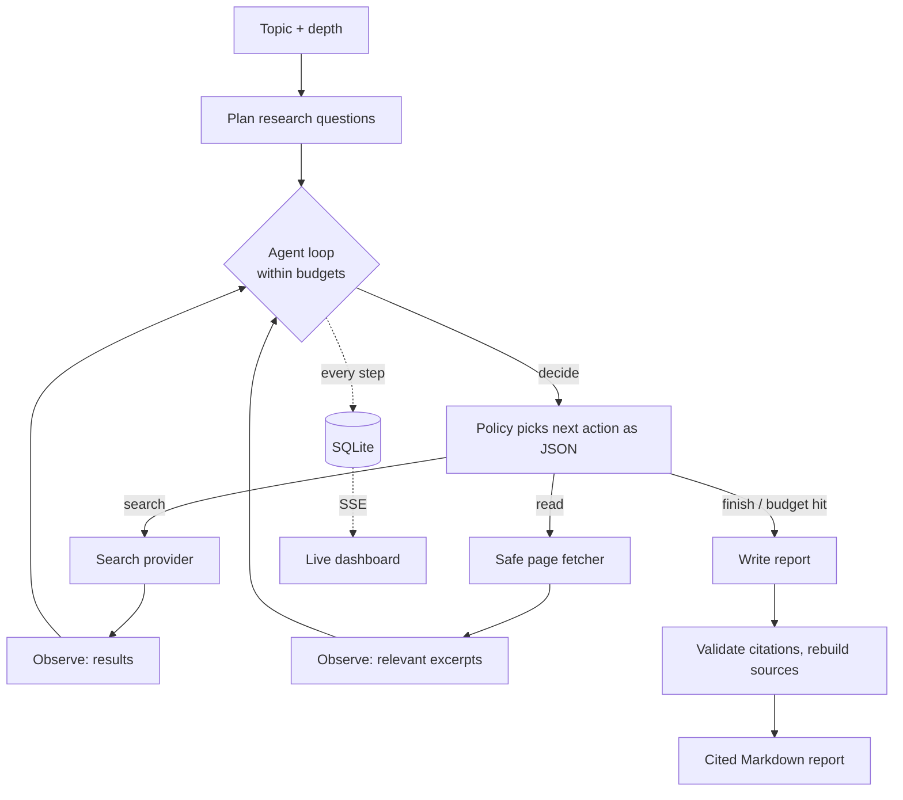

# ResearchAgent

**An autonomous research agent that plans, searches, reads, and writes cited reports, with a live step-by-step dashboard.**

Give it a topic. It breaks the topic into research questions, searches the web, reads the most
relevant pages, and writes a Markdown report where every claim carries a numbered citation. You
watch each step happen in real time, see exactly what it searched and read, and get a token and cost
summary for every run.

> 🎥 **Demo:** _add a GIF or screenshot here_ · 🌐 **Live:** _add your deployed URL here_

## How it works



The same loop runs with two interchangeable "brains":

| Mode | Cost | What it does |
|---|---|---|
| `heuristic` (default) | Free, offline | A scripted plan (overview, history, how it works, ...) with extractive reporting. No LLM. |
| `openai_compatible` / `anthropic` | Free tiers, local, or paid | The model plans, picks every next action, and writes a synthesised, cited report. |

## What makes it trustworthy

An agent that browses the web and writes with an LLM has real failure modes. Each one is handled
explicitly, and covered by tests:

- **Tool use over a validated JSON protocol:** every action is parsed into a typed union (`search | read | finish`). Invalid replies get one retry with the error fed back, then a safe fallback. It works with any chat model, including free ones without native function calling.
- **The model can only read URLs that a search returned.** It can't be talked into fetching an arbitrary address.
- **SSRF protection:** only http(s), only public IPs (loopback, private, link-local and cloud-metadata ranges are blocked), and every redirect hop is re-checked. Response size and time are capped.
- **Prompt-injection hygiene:** web content is wrapped in `<source>` tags and the system prompts mark it as untrusted data. The report is also rendered through a Markdown renderer that never emits raw HTML.
- **Citations can't be invented:** after writing, any `[n]` that doesn't match a real source is removed and the Sources list is rebuilt from what was actually read, never taken from the model.
- **Hard budgets:** pages, tool calls, tokens, and wall-clock time. The agent stops early, notes why, and still writes a report from what it has.
- **Failures are data, not crashes:** a failed search or page becomes an error step the agent adapts to. A run can never stay stuck in "running": unexpected errors are recorded, and unfinished runs are failed on restart.
- **Cancellation:** stop a run at any time; queued runs cancel instantly, running ones at the next step.
- **Honest accounting:** tokens are counted per step (including decisions that produce no step of their own), with an optional price-per-million setting for a cost estimate.

## Quick start (100% free, no API keys)

Requires Python 3.11+ and Node 20+.

```bash
git clone https://github.com/<you>/research-agent && cd research-agent
cp .env.example .env              # defaults to free heuristic mode + Wikipedia search
python -m venv .venv && source .venv/bin/activate
pip install -e ".[dev]"
uvicorn app.main:app --reload     # API on http://localhost:8000 (docs at /docs)
```

In a second terminal:

```bash
cd web && cp .env.example .env.local && npm install && npm run dev   # UI on http://localhost:3000
```

Open http://localhost:3000, pick a topic or an example chip, and watch the agent work.
Set your contact details in `USER_AGENT` in `.env`, since Wikipedia asks API clients to identify themselves.

### Getting written reports for free

Uncomment one block in `.env`: **Groq**, **Google Gemini**, or **OpenRouter** (`:free` models) need a
free API key and no credit card; **Ollama** runs a model locally and offline. Free-tier limits and
model names change often, so check each provider's page. A "Standard" run makes roughly 10 to 14 model calls.

### Searching beyond Wikipedia

`SEARCH_PROVIDER=duckduckgo` (after `pip install -e ".[ddg]"`) searches the open web with no key, or
point `searxng` at your own instance. DuckDuckGo access scrapes, so it can rate-limit or break.

## API

| Method | Path | Description |
|---|---|---|
| `POST` | `/runs` | Start a run `{"topic": "...", "depth": "quick|standard|deep"}` |
| `GET` | `/runs` | List runs |
| `GET` | `/runs/{id}` | A run with its steps and report |
| `GET` | `/runs/{id}/events?after=N` | Server-Sent Events: `step`, `run`, `end` |
| `POST` | `/runs/{id}/cancel` | Cancel a run |
| `GET` | `/runs/{id}/report.md` | Download the report |
| `DELETE` | `/runs/{id}` | Delete a finished run |

## Design decisions and trade-offs

- **One loop, swappable policies.** Budgets, logging, cancellation, and tool execution live in one place; the "brain" is a small interface. That made a fully offline mode possible and every behaviour testable with a scripted fake model.
- **JSON actions instead of native function calling.** Slightly more parsing work, but it runs on any model, which matters when the goal is free and local options.
- **Stateless model calls.** Each decision gets a compact summary of state (excerpts, not whole pages) instead of a growing chat history, which keeps token use flat and free-tier limits manageable.
- **Extractive evidence selection.** Pages are reduced to the few sentences that best match the question before the model ever sees them. It is cheap and transparent, but it is not semantic search.
- **Threads + SQLite + SSE.** A bounded thread pool runs agents, SQLite stores every step, and the stream simply tails the database. It is simple and restart-safe; a queue such as Celery would be the next step for multiple servers.

## Known limitations

- Pages that need JavaScript to render, PDFs, and paywalled content aren't readable.
- The SSRF check resolves DNS before fetching, so a hostile DNS server could in theory change its answer between check and connect (DNS rebinding). Pin the resolved IP, or add an egress firewall, before exposing this publicly.
- Free mode produces an extractive digest, not a synthesis. Quality in LLM mode depends on the model.
- There is no authentication, so run it locally or behind your own gateway.

## Roadmap

- [ ] Semantic reranking of excerpts with local embeddings
- [ ] Follow-up questions and report revision
- [ ] PDF reading and a headless-browser fetcher
- [ ] Postgres and a job queue for multi-user deployment
- [ ] Evaluation set: citation precision and source diversity

## Project layout

```
app/
  main.py          FastAPI routes, SSE stream, thread pool
  agent/
    loop.py        the agent loop, budgets, step recording
    policy.py      heuristic and LLM policies, report finalisation
    llm.py         OpenAI-compatible and Anthropic completers
    text.py        keyword and excerpt selection
    state.py       run state and usage
  tools/
    search.py      Wikipedia, DuckDuckGo, SearXNG
    fetch.py       SSRF-safe page fetching and HTML extraction
  models.py, repo.py, db.py, config.py
web/               Next.js (App Router, TypeScript) live dashboard
tests/             pytest suite (52 tests)
```

## License

MIT
